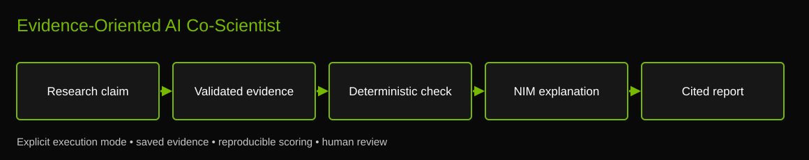

# Evidence-Oriented AI Co-Scientist

Check research claims against executable numerical evidence, preserve the evidence chain, and use NVIDIA NIM to explain the checked result. NeMo Fabric controls the custom agent lifecycle and NeMo Relay records tool/model activity.

[繁體中文快速入門](README.zh-TW.md) · [Playbook](docs/PLAYBOOK.md) · [Validation](VALIDATION.json) · [Sources and licenses](docs/SOURCES.md)



## Start with the offline tutorial

Use an independent Python environment for each repository: these teaching projects intentionally share the package name `project_demo`. Python 3.12 is recommended.

```bash
python -m venv .venv
# Linux/macOS: source .venv/bin/activate
# Windows: .venv\Scripts\activate
python -m pip install -e .
python -m project_demo prepare --output-dir runs/preparation
python -m project_demo demo --mode fixture --output-dir runs/fixture
python -m unittest discover -s tests -v
```

Fixture outputs are labelled authored examples. They validate the program and scoring rules; they are never presented as model execution. Every invocation writes a new run directory. Live failures remain failures, with error details and request-attempt accounting.

## Method and scope

The deterministic tool calculates the difference in accuracy in percentage points from integer correct/total counts. It verifies the test-set identity and required citation IDs. The model cannot change the checked verdict or citation list. Four cases cover a supported comparison, missing evidence, wrong citations, and a wrong numerical claim. Input text never becomes executable Python or a shell command.

This is a companion implementation of evidence-oriented programming concepts. The authored experiment records are illustrative, not published scientific results or an autonomous-discovery benchmark. No unidentified paper is claimed to be reproduced.

Claim-decision accuracy is scored against the authored case labels. A complete citation chain does not prove experimental validity; the numerical experiment itself and the prose explanation still require human review.

## Tutorials

- [Interactive introduction](https://colab.research.google.com/github/virginiakm1988/ai-coscientist-nvidia/blob/main/notebooks/01_interactive_demo.ipynb)
- [Evaluation and reproducibility](notebooks/02_evaluation.ipynb)

## Run the NVIDIA pipeline

```bash
python -m pip install -e '.[agents]'
# Set NVIDIA_API_KEY securely in the environment, never in a notebook cell.
python -m project_demo sdk-check --mode fixture --output-dir runs/sdk-check
python -m project_demo demo --mode live --engine fabric --output-dir runs/live
```

`sdk-check` exercises the real Fabric lifecycle and Relay instrumentation using authored fixture data. It does not call a model. The live default uses Fabric; `--engine python` is a troubleshooting path that calls the same workflow directly. Requests use the NVIDIA NIM REST interface. No NAT dependency is used. Endpoint availability depends on the account; configure model IDs and endpoints rather than silently replacing a failed model.

Fabric 0.6.1 and Relay 0.11.1 are pinned to the compatible published package versions. The adapter implements `start`, `invoke`, and `stop`, validates typed runtime context, and only executes this installed workflow. Relay traces are local and full-payload export is disabled by default.

### Helix evaluation on a remote Python 3.12 runtime

```bash
python -m pip install -r requirements-helix.txt
python -m project_demo.helix_evaluate --results runs/live/<run-id>/result.json --output-dir runs/helix
```

This uses the real NeMo Helix `AgentEvaluator` SDK to rescore captured structured trials and persist a dashboard. It does not start the full control plane or make additional model calls. The SDK source commit is pinned because this package is not separately available on PyPI. Source execution mode is retained in trial metadata. See validation status for the platforms actually tested.

## Public references

- [Original EOP teaching project](https://github.com/virginiakm1988/EOP_agent_tutorial)
- [NeMo Fabric](https://github.com/NVIDIA/NeMo-Fabric)
- [NeMo Relay](https://github.com/NVIDIA/NeMo-Relay)
- [NeMo Helix](https://github.com/NVIDIA-NeMo/nemo-helix)

## Licensing and publication

New code and authored teaching data are Apache-2.0. Third-party models, source projects, and SDKs keep their own licenses. We do not redistribute their model weights. No organizational achievement or paper result is inferred from these small demonstrations. See [source notes](docs/SOURCES.md) for versions and method differences.

## Recorded execution

[Actual live NIM + Fabric/Relay result](evidence/live-nim-fabric.json) includes per-case outputs, metrics, versions, and elapsed time. Local SDK lifecycle checks and captured-trial Helix scoring also completed. See `VALIDATION.json` for exact scope; tiny teaching cases are not paper benchmark results.
